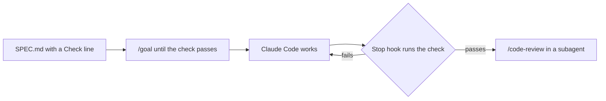

# Gate the goal with a Stop hook

## The problem

You tell Claude Code "fix the drift" and walk away. It says it is done. It is not. A goal needs a stop condition
a script can check, so "done" is a fact and not a mood. A Stop hook runs when Claude Code tries to stop. If the
check fails, the hook sends it back to work.

For example, Claude Code says "done", the plan still shows drift, and the hook sends it back.



## Your challenge

Start Claude Code in the root folder of this course repo, and give it this job:

```text
Interview me about putting prod's buyer records bucket back, one question at a time. Then in
parts/04-run-it-without-you/09-gate-the-goal-with-a-stop-hook/problem/ write SPEC.md with Goal, Done when and
Out of scope. Done when holds one line that starts Check: and is a read-only command. Write
.claude/hooks/stop-gate.sh, a Stop hook that runs that line and exits 2 when it fails, and exits 0 when
stop_hook_active is true. Wire it in .claude/settings.json. Write goal.txt with a /goal line that repeats the
check, stops after a number of turns, and asks for /code-review in the code-reviewer subagent. Write
.claude/agents/code-reviewer.md with tools that cannot Edit or Write. Show me your plan first.
```

Read the plan. Could the Check line change prod? Could the hook trap the session in a loop?

The prompts that solve this step are in `../solution/prompts.md`. Read them after you try.

## Done when

- `SPEC.md` has Goal, Done when and Out of scope, and one read-only `Check:` line.
- The Stop hook blocks when the check fails and lets Claude Code stop when it passes.
- The hook lets a second stop through.
- `goal.txt` has a `/goal` line with the check, a turn limit and `/code-review`.
- The reviewer subagent cannot Edit or Write.

```bash
bun run verify gate-the-goal-with-a-stop-hook
```

Expect: `Done. All 7 rules pass.`

## If you get stuck

| What you see | What to ask Claude Code |
|---|---|
| `FAIL the hook blocks when the check fails` | "Exit 2 when the Check command fails, and print why on stderr." |
| `FAIL the hook lets a second stop through` | "Exit 0 when stop_hook_active is true." |
| `FAIL the reviewer subagent cannot Edit or Write` | "Set tools to Read, Grep, Glob and Bash." |

## Words you will use

- **Stop condition**: a check a script can run that says the goal is met.
- **Stop hook**: a script Claude Code runs when it tries to stop.
- **Subagent**: a helper with its own tools and its own context.
