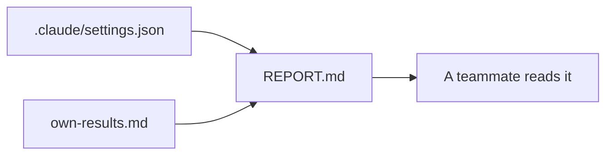

# Report on your own repo

## The problem

Every step so far used the course repo. A team does not care about it. They care about yours. This last step
asks for one page about your own repo, backed by files a reviewer can open. The check reads your page and your files.
It never reads the course repo.



## Your challenge

Put your own repo's files next to this page, in `problem/`: your `.claude/settings.json` and the results from the last step. Start Claude Code in the root folder of this course repo, and give it this job:

```text
Read .claude/settings.json and own-results.md. Fill REPORT.md with five sections: Repo, What I fenced, Evidence,
What it does not stop, Next step. In Evidence paste the command and the Blocked and Allowed lines from
own-results.md. Name a person in Next step. Use no example from the course. Show me the file first.
```

Then check it:

```bash
bun run verify report-on-your-own-repo
```

Expect: `Done. All 6 rules pass.`

The prompts that solve this step are in `../solution/prompts.md`. Read them after you try.

## Done when

- `REPORT.md` has the five sections, each with text.
- `.claude/settings.json` has at least three deny rules.
- Evidence holds a command and counts that match `own-results.md`.
- The page names no course example, and Next step names a person.

## If you get stuck

| What you see | What to ask Claude Code |
|---|---|
| `FAIL the evidence counts match own-results.md` | "Copy the Blocked and Allowed lines from own-results.md word for word." |
| `FAIL the report is about your repo` | "Remove every course name and write about my repo." |

## Words you will use

- **Evidence**: a file or a count a reader can open and check.
- **Capstone**: the last piece, done on your own work.
