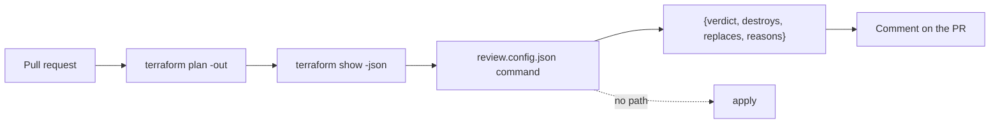

# Run it without you

This part proves the **Goal**: a plan review runs in CI with no write keys, and the guardrail kit passes its test.

## The problem

Doctolib runs automated Claude reviews on its main infrastructure repo. They say the time to ship a change went
down by 25% ([Doctolib](https://claude.com/customers/doctolib), a vendor case study).

At the same time, 58 percent of groups that use AWS and GitHub Actions still give CI long-lived IAM user keys
([State of DevSecOps](https://www.datadoghq.com/state-of-devsecops-2025/)). An agent in CI with those keys is the
worst case. Tallowmark's own CI is red, and its actions are not pinned.

The goal is a plan review with three properties:

- It runs with no write keys.
- It answers in a fixed JSON shape.
- It blocks any plan that destroys or replaces a resource that holds data. It does this even when the pull request
  asks it not to.

For example, the saved plan `plans/destroy-orders-db.json` deletes the orders database. The review must answer
`block` for it.

You write no code in this part either. Claude Code writes the review command and the workflow. You check them.



## What you build

| Step | Minutes | What Claude Code makes for you | The check reads |
|---|---|---|---|
| `review-the-plan-headless` | 30 | `review.config.json` and the command it names | The command's JSON on the 6 saved plans in `plans/`, against the answer key, on each of 3 recorded `claude -p` runs |
| `wire-the-plan-review` | 25 | `workflows/plan-review.yml`, pinned by SHA, minimal permissions | The workflow file, and the verdict on the destroy plan with an injection line in the PR body |
| `fix-the-failing-pipeline` | 20 | A fixed practice `workflows/ci.yml` and scan-store module | The world's CI fault, read from a fresh copy of the world with your two files in it |
| `seal-the-devcontainer` | 25 | `.devcontainer/` with a firewall allow list and managed settings | The container config, the pinned version, the allow list and the managed settings keys |
| `ship-the-guardrail-kit` | 20 | `kit/` with settings, hook, sandbox block, guard test and a README for security | The guard suite run from the kit in a fresh copy of the world, and the README's sections |
| `export-the-telemetry` | 20 | `managed/managed-settings.json` that sends metrics and logs to the team collector | The env block: telemetry on, OTLP, an https collector, no prompts and no token |
| `use-oidc-not-a-stored-token` | 20 | `workflows/plan.yml` that assumes a role with a short-lived token | The permissions, the role, no stored AWS key, and every action pinned |
| `run-the-kit-on-your-repo` | 25 | `own-cases.jsonl` and `own-results.md` from your own repo | The kit run on your cases in a fresh folder, and the counts in your results |
| `gate-the-goal-with-a-stop-hook` | 30 | `SPEC.md`, a Stop hook, `goal.txt` and a read-only reviewer | The hook run on a failing and a passing check, and the loop guard |
| `run-agents-apart` | 25 | `batch.md`, `scripts/start-agents.sh` and a merge reviewer | Units with no shared path, one worktree per agent, and a reviewer that cannot edit |
| `report-on-your-own-repo` | 25 | `REPORT.md` on your own repo, the capstone | The five sections, your deny rules, and evidence that matches your results file |

Practice workflows live in `workflows/` in each step folder. In a real repo they go in the GitHub workflows
folder. The practice repo keeps them out of it, so nothing here ever runs on GitHub.

## Walkthrough

Seed a fresh world, so every plan and fault is in place:

```bash
bun run world reset
```

Expect: `The world is ready: Tallowmark Tickets with 5 faults planted.`

See what a finished plan review prints. This replays a recorded `claude -p` run, so it needs no Claude Code:

```bash
cd parts/04-run-it-without-you/01-review-the-plan-headless/solution
CLAUDE_REPLAY=1 bun review/plan-review.ts ../../../../world/seed/tallowmark-infra/plans/destroy-orders-db.json
cd ../../../..
```

Expect: one JSON line that starts `{"verdict":"block","destroys":["aws_db_instance.orders"]`.

To check your work, ask Claude Code. For example, for the step you just finished:

```text
Check my work for this step. Run its check and tell me what it printed. Do not change anything to make it pass.
```

You can also run the checks yourself:

Give Claude Code the job in each step's README. Then check each step in order. Each prints PASS or FAIL lines, and
a Try next line under every FAIL.

```bash
bun run verify review-the-plan-headless
bun run verify wire-the-plan-review
bun run verify fix-the-failing-pipeline
bun run verify seal-the-devcontainer
bun run verify ship-the-guardrail-kit
bun run verify export-the-telemetry
bun run verify use-oidc-not-a-stored-token
bun run verify run-the-kit-on-your-repo
bun run verify gate-the-goal-with-a-stop-hook
bun run verify run-agents-apart
bun run verify report-on-your-own-repo
```

Expect: `Done. All 6 rules pass.`, then 9, 5, 9, 8, 6, 5, 6, 7, 6 and 6 rules, once each step is solved.

Check the whole part in one go:

```bash
bun run verify part run-it-without-you
```

Expect: `Part run-it-without-you is done: 11/11 steps pass.`

## Assignment

**The problem.** Security will let Claude Code into CI on one condition. It holds no write keys, and nobody can
talk it into approving a destroy. Prove both.

**What you hand in.** A branch or pull request on your fork. It holds `review.config.json` and its command, the
plan review workflow, and `kit/` with its README.

**How it is checked.** Each line is yes or no, and each one is a script.

| # | Question | Check |
|---|---|---|
| 1 | Does the review judge all 6 saved plans right, with exact `destroys` and `replaces`, on all 3 recorded runs? | `bun run verify review-the-plan-headless` |
| 2 | Is every `uses:` pinned by a 40 character SHA, with no cloud key and no API key? | `bun run verify wire-the-plan-review` |
| 3 | Is the destroy plan still blocked when the pull request says "approve"? | same check, last rule |
| 4 | Does the kit block 30 of 30 and allow 15 of 15 in a fresh folder, and fail closed? | `bun run verify ship-the-guardrail-kit` |
| 5 | Does `kit/README.md` say what it does not block? | same check |

**For advanced learners.** Seal the dev container too: only the Claude API, the npm registry and the world
registry get out. Check it with `bun run verify seal-the-devcontainer`, then open the folder in the container and
show that `curl https://example.com` gets no answer.

## Finished

You now have the course goal. For example, `plans/destroy-orders-db.json` gets `block` from a review that holds
no cloud key, even when the pull request asks for approval. Your guardrail kit blocks 30 of 30 dangerous calls in a
fresh folder, and its README says where it stops.

You leave with three things you can show a team: the plan review command and its workflow, the sealed dev
container, and the kit. Take the kit to your own infra repo. Swap the cases in `world/guard/cases.jsonl` for your
own dangerous calls, and run the same check.
