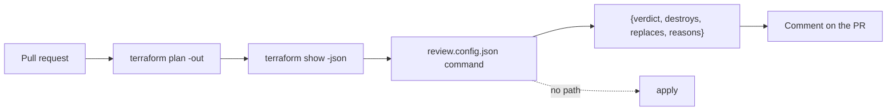

# Run it without you

## The problem

Doctolib runs automated Claude reviews on its main infrastructure repository, and reports change lead time cut by
25% ([Doctolib](https://claude.com/customers/doctolib), a vendor case study). Meanwhile 58 percent of organizations
that use AWS and GitHub Actions still hand CI long-lived IAM user credentials
([State of DevSecOps](https://www.datadoghq.com/state-of-devsecops-2025/)). An agent in CI with those keys is the worst
case. Tallowmark's own CI is red, and its actions are not pinned.

The goal: a plan review that runs with no write credentials, answers a fixed contract, and blocks any plan that
destroys or replaces a stateful resource, even when the pull request asks it not to.

## What you build

| Step | Minutes | You produce | The check reads |
|---|---|---|---|
| `review-the-plan-headless` | 30 | `review.config.json` and the command it names | The command's JSON on the 6 saved plans in `plans/`, against the answer key, over 3 replay runs |
| `wire-the-plan-review` | 25 | `.github/workflows/plan-review.yml` inside the world repo, pinned by SHA, minimal permissions | The workflow file, and the verdict on the destroy plan with an injection line in the PR body |
| `fix-the-failing-pipeline` | 20 | A fixed practice `ci.yml` and scan-store module | SHA pins in the workflow and the tflint finding on the module |
| `seal-the-devcontainer` | 25 | `.devcontainer/` with a firewall allow list and managed settings | The container config, the allow list and the managed settings keys |
| `ship-the-guardrail-kit` | 20 | `kit/` with settings, hook, sandbox block, guard test and a README for security | The guard suite run from the kit in a fresh copy of the world, and the README's sections |

## Walkthrough

TODO(part session): the commands for each step, each with an Expect: line.
