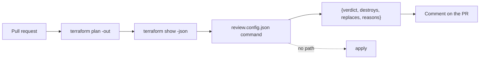

# Run it without you

This part proves the **Goal**: a plan review runs in CI with no write keys, and the guardrail kit passes its test.

## The problem

Doctolib runs automated Claude reviews on its main infrastructure repo. They say the time to ship a change went
down by 25% ([Doctolib](https://claude.com/customers/doctolib), a vendor case study).

At the same time, 58 percent of groups that use AWS and GitHub Actions still give CI long-lived IAM user keys
([State of DevSecOps](https://www.datadoghq.com/state-of-devsecops-2025/)). An agent in CI with those keys is the
worst case. Tallowmark's own CI is red, and its actions are not pinned.

The goal is a plan review with three properties:

- It runs with no write keys.
- It answers in a fixed JSON shape.
- It blocks any plan that destroys or replaces a resource that holds data. It does this even when the pull request
  asks it not to.

For example, the saved plan `plans/destroy-orders-db.json` deletes the orders database. The review must answer
`block` for it.

You write no code in this part either. Claude Code writes the review command and the workflow. You check them.

## What you build

| Step | Minutes | What Claude Code makes for you | The check reads |
|---|---|---|---|
| `review-the-plan-headless` | 30 | `review.config.json` and the command it names | The command's JSON on the 6 saved plans in `plans/`, against the answer key, on each of 3 recorded `claude -p` runs |
| `wire-the-plan-review` | 25 | `.github/workflows/plan-review.yml` inside the world repo, pinned by SHA, minimal permissions | The workflow file, and the verdict on the destroy plan with an injection line in the PR body |
| `fix-the-failing-pipeline` | 20 | A fixed practice `ci.yml` and scan-store module | SHA pins in the workflow and the tflint finding on the module |
| `seal-the-devcontainer` | 25 | `.devcontainer/` with a firewall allow list and managed settings | The container config, the allow list and the managed settings keys |
| `ship-the-guardrail-kit` | 20 | `kit/` with settings, hook, sandbox block, guard test and a README for security | The guard suite run from the kit in a fresh copy of the world, and the README's sections |

## Walkthrough

TODO(part session): the commands for each step, each with an Expect: line.
