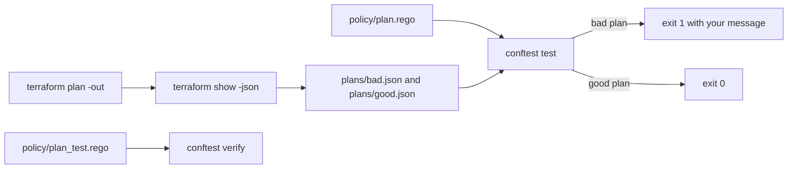

# Check infrastructure rules with Conftest

This closing part redoes one thing you built by hand with the open-source tool teams run in production. Nothing
earlier in the course changes. You still review a plan in chat first, then turn that review into a policy.

## Problem

In Run it without you, Claude Code reviews a plan and answers `block` for a plan that deletes the orders database. That
review lives in a command you wrote with a prompt. A team wants the same rule in a form every pipeline can run and
every reviewer can read.

Conftest is a small command line tool. It runs rules written in Rego, the policy language of Open Policy Agent,
against a JSON file. Terraform can print its plan as JSON, so a rule can read the plan.

For example, one rule says a plan must not delete the orders database. Conftest fails the plan and prints which resource broke the rule.

## Why it matters

A rule in chat is forgotten when the chat ends. A rule in a policy file runs on every plan, fails with a message,
and has its own tests. Conftest is open source, and the same Rego language is used across Kubernetes.

## What we teach

- Export a plan with `terraform show -json`, and read the JSON a plan holds.
- Ask Claude Code to write one Rego rule from your review list, and run `conftest test`.
- Read the failure message and decide if it tells a reader what to fix.
- Keep the rule honest with `conftest verify`, which runs unit tests written in Rego.



## Steps

| Step | Minutes | What Claude Code makes for you | The check reads |
|---|---|---|---|
| `write-the-plan-policy` | 20 | `policy/plan.rego` and `policy/plan_test.rego` | Conftest's exit code on a bad plan, a good plan and the unit tests |

The same work is the take-home assignment in `assignment/`. It is optional in the live session and expected as
homework.

## Options

Conftest is the pick for this part. Checkov is the runner-up.

- **Choose when:** you want many ready-made checks without writing Rego.
- **Trade-off:** you learn its rule set, not a policy language.

## Walkthrough

Conftest is pinned to one exact release. The check downloads that exact release into `.cache/` if your machine
does not have it, and verifies its checksum.

See the finished policy catch the bad plan and pass the good one:

```bash
bun run verify write-the-plan-policy solution
```

Expect: `Done. All 3 rules pass.`

Give Claude Code the job in the step README. Then ask it to check your work:

```text
Check my work for this step. Run its check and tell me what it printed. Do not change anything to make it pass.
```

You can also run the check yourself:

```bash
bun run verify write-the-plan-policy
```

Expect: `Done. All 3 rules pass.` once your policy works, and a `Try next` line under each rule that does not.

Check the whole part in one go:

```bash
bun run verify part check-infrastructure-rules-with-conftest
```

Expect: `Part check-infrastructure-rules-with-conftest is done: 1/1 steps pass.`

## Finished

You now have a rule that gates a plan, with a message and tests. Take it to your own repo: swap the types in
`data_types` for the resources that hold your data, and run the same `conftest test` in your pipeline.
