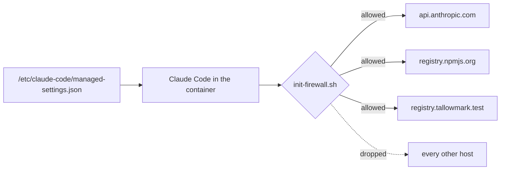
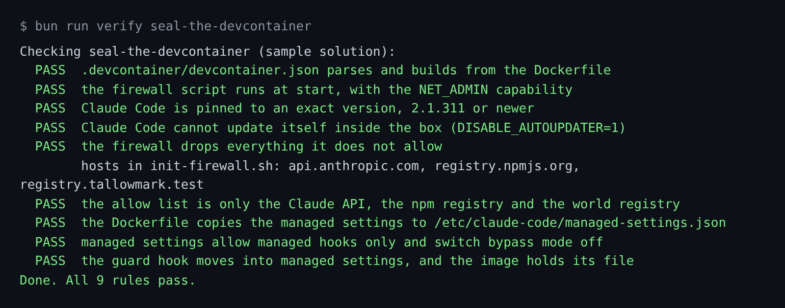

# Seal the devcontainer

## The problem

Claude Code runs commands near your keys. Once, 19 bad versions of `nx` packages ran a script when installed. It
searched the disk for credentials and posted them to a public repo
([Nx advisory GHSA-cxm3-wv7p-598c](https://github.com/nrwl/nx/security/advisories/GHSA-cxm3-wv7p-598c)). A box with
a firewall stops that. For example, inside the box `curl https://example.com` gets no answer.

## Watch it done

The firewall lets three hosts through. Managed settings sit above every repo file, so the repo cannot undo them.



The check on the empty starter ends like this, and on the sample answer it passes all 9 rules:

```text
FAIL  the firewall drops everything it does not allow
hosts in init-firewall.sh: none
0 of 9 rules pass.
```

## Your turn

1. Start Claude Code in the root folder of this course repo. Expect: a prompt.
2. Give it this job:

   ```text
   Read https://code.claude.com/docs/en/devcontainer and the managed settings page in the same docs.
   In parts/05-ship-the-kit/01-seal-the-devcontainer/problem/.devcontainer/ write devcontainer.json, a
   Dockerfile, init-firewall.sh and managed-settings.json.
   The Dockerfile installs @anthropic-ai/claude-code at the exact version that claude --version prints, sets
   DISABLE_AUTOUPDATER=1, and copies managed-settings.json to /etc/claude-code/managed-settings.json.
   The firewall drops everything except api.anthropic.com, registry.npmjs.org and registry.tallowmark.test.
   It runs at start, with --cap-add=NET_ADMIN. Managed settings set allowManagedHooksOnly to true and
   disableBypassPermissionsMode to disable. Then the repo's hook stops running, so copy
   .claude/hooks/guard-infra.ts into /etc/claude-code/hooks/ and wire it in the managed settings.
   Show me your plan first.
   ```

   Expect: a plan, before any file is written.
3. Count the hosts in the plan. Expect: exactly three.
4. Say yes. Expect: four files in `.devcontainer/`.

## Do it on your work

Ask for the same box around your own repo, and name the hosts your build needs. Good looks like a short allow list
you can read in one breath. Every extra host is a way out.

## Done when

- The firewall drops by default and allows only the three hosts.
- Claude Code is pinned to an exact version and cannot update itself.
- Managed settings allow managed hooks only, switch bypass mode off, and carry the guard hook.

```bash
bun run verify seal-the-devcontainer
```

Expect: `Done. All 9 rules pass.`



## Solution

See `../solution/`. The diff adds the four `.devcontainer/` files. The prompts are in `../solution/prompts.md`.
Read them after you try.

## If you get stuck

| What you see | What to ask Claude Code |
|---|---|
| `hosts in init-firewall.sh: ... github.com ...` | "Remove every host except the three. A blocked install is safer than an open box." |
| `FAIL Claude Code is pinned to an exact version` | "Pin @anthropic-ai/claude-code to the exact version that claude --version prints, not latest." |
| `FAIL the guard hook moves into managed settings` | "allowManagedHooksOnly turns off the repo's hook. Wire the guard in managed settings." |

## Words you will use

- **Dev container**: a container your editor opens your project in, defined by `.devcontainer/devcontainer.json`.
- **Allow list**: the only hosts the firewall lets through. Everything else is dropped.
- **Managed settings**: settings in a system folder. They sit above every other settings file.
