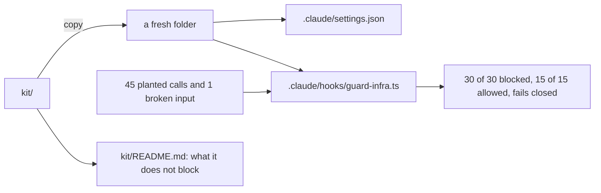
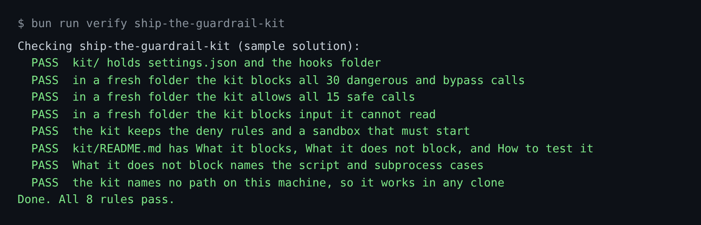

# Ship the guardrail kit

## The problem

Your guardrails work in this repo. Security asks the next question: can another team use them, and what do they
not stop?

A kit that only works on your laptop is not a kit. A kit that claims to stop everything is not believed. A
reviewer trusts the team that writes down the limits.

For example, the hook reads `bash scripts/rotate-logs.sh` and finds the `terraform destroy` inside it. But if a
Python program starts `terraform destroy` as a subprocess, the hook never sees that command. The kit's README must
say so.

This step is the course goal. When it passes, the guard you built in Fence the agent works in a fresh folder, with no
help from this repo.



## Your challenge

Get Claude Code to package the kit. You write no code. Start Claude Code in the root folder of this course repo,
and give it this job:

```text
In parts/05-ship-the-kit/02-ship-the-guardrail-kit/problem/, make a kit/ folder for another team.
Copy .claude/settings.json to kit/settings.json, .claude/hooks/ to kit/hooks/, and
.devcontainer/managed-settings.json to kit/managed-settings.json.
The hook path must use $CLAUDE_PROJECT_DIR, never a path on this machine.
Then write kit/README.md for a security reviewer, with three sections:
What it blocks, What it does not block, How to test it.
Read world/guard/cases.jsonl for What it blocks. In What it does not block, be honest:
include subprocesses a program starts and scripts the hook cannot read. Show me your plan first.
```

Read the README before you say yes. Would a security reviewer believe it? Ask Claude Code to remove any line that
claims more than the test proves.

The prompts that solve this step are in `../solution/prompts.md`. Read them after you try.

## Done when

- `kit/` holds `settings.json` and `hooks/`, and names no path on this machine.
- Copied into a fresh folder, the kit blocks all 30 dangerous and bypass calls and allows all 15 safe calls.
- It blocks input it cannot read, and keeps the deny rules and the sandbox.
- `kit/README.md` has the three sections, and What it does not block names the script and subprocess cases.

```bash
bun run verify ship-the-guardrail-kit
```

Expect: `Done. All 8 rules pass.`



## If you get stuck

| What you see | What to ask Claude Code |
|---|---|
| `FAIL in a fresh folder the kit blocks all 30` | "Copy the hooks folder into kit/ too. The settings point at it." |
| `FAIL kit/README.md has What it blocks, ...` | "Add the section What it does not block. A reviewer reads it first." |
| `FAIL the kit names no path on this machine` | "Use $CLAUDE_PROJECT_DIR in the hook command." |

## Words you will use

- **Kit**: the files another team copies to get the same guardrails.
- **Fresh folder**: an empty folder with only the kit in it. It proves the kit needs nothing else.
- **Subprocess**: a program that another program starts. The hook only sees what Claude Code types.
