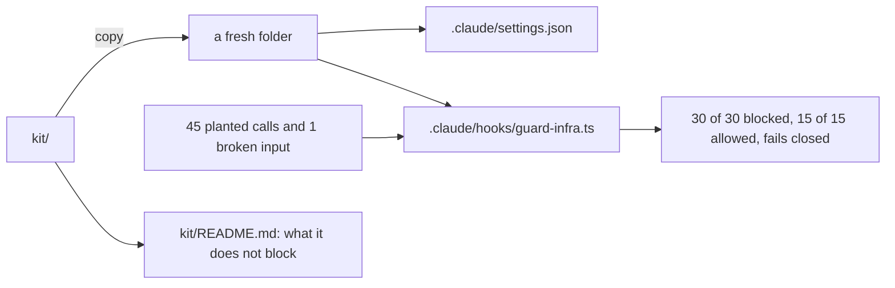

# Ship the guardrail kit

## The problem

Another team asks if they can use your guardrails, and what the guardrails miss. A reviewer trusts the team that
writes down the limits. For example, the hook finds `terraform destroy` inside a shell script. But when a Python
program starts that command itself, the hook never sees it.

## Watch it done

The kit is copied into a fresh folder. The same planted calls must pass there, with no help from this repo.



The check on the empty starter ends like this, and on the sample answer it passes all 8 rules:

```text
FAIL  kit/README.md has What it blocks, What it does not block, and How to test it
0 of 8 rules pass.
```

## Your turn

1. Start Claude Code in the root folder of this course repo. Expect: a prompt.
2. Give it this job:

   ```text
   In parts/05-ship-the-kit/02-ship-the-guardrail-kit/problem/, make a kit/ folder for another team.
   Copy .claude/settings.json to kit/settings.json, .claude/hooks/ to kit/hooks/, and
   .devcontainer/managed-settings.json to kit/managed-settings.json.
   The hook path must use $CLAUDE_PROJECT_DIR, never a path on this machine.
   Then write kit/README.md for a security reviewer, with three sections:
   What it blocks, What it does not block, How to test it.
   Read world/guard/cases.jsonl for What it blocks. In What it does not block, be honest:
   include subprocesses a program starts and scripts the hook cannot read. Show me your plan first.
   ```

   Expect: a plan, before any file is written.
3. Read the kit README. Ask Claude Code to remove any line that claims more than the test proves. Expect: a
   shorter, more honest page.

## Do it on your work

Hand the kit to one person on another team. Ask them to name one thing it misses, and add it to What it does not
block. Good looks like a reviewer who reads the limits first and still says yes.

## Done when

- `kit/` holds `settings.json` and `hooks/`, and names no path on this machine.
- In a fresh folder the kit blocks all 30 dangerous calls and allows all 15 safe ones.
- `kit/README.md` has the three sections, and the script and subprocess cases are named.

```bash
bun run verify ship-the-guardrail-kit
```

Expect: `Done. All 8 rules pass.`


## Solution

See `../solution/`. The diff adds the `kit/` folder with settings, hooks and its README. The prompts are in
`../solution/prompts.md`. Read them after you try.

## If you get stuck

| What you see | What to ask Claude Code |
|---|---|
| `FAIL in a fresh folder the kit blocks all 30` | "Copy the hooks folder into kit/ too. The settings point at it." |
| `FAIL kit/README.md has What it blocks, ...` | "Add the section What it does not block. A reviewer reads it first." |
| `FAIL the kit names no path on this machine` | "Use $CLAUDE_PROJECT_DIR in the hook command." |

## Words you will use

- **Kit**: the files another team copies to get the same guardrails.
- **Fresh folder**: an empty folder with only the kit in it. It proves the kit needs nothing else.
- **Subprocess**: a program that another program starts. The hook only sees what Claude Code types.
