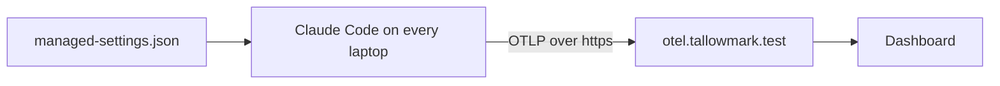

# Export the telemetry

## The problem

The platform team needs to know who runs Claude Code and what it costs. Asking each person to set a variable fails,
because people forget. One managed settings file turns it on for everyone. For example, the dashboard shows 40
sessions yesterday and their cost.

## Watch it done

Claude Code sends metrics and logs as OpenTelemetry, a standard way to send them to a collector, a server that
feeds a dashboard.



The check on the empty starter ends like this, and on the sample answer it passes all 6 rules:

```text
FAIL  telemetry is switched on
2 of 6 rules pass.
```

## Your turn

1. Start Claude Code in the root folder of this course repo. Expect: a prompt.
2. Give it this job:

   ```text
   Read the monitoring page in the Claude Code docs. In
   parts/05-ship-the-kit/03-export-the-telemetry/problem/managed/managed-settings.json keep
   allowManagedHooksOnly and add an env block. Turn telemetry on. Export metrics and logs with OTLP over grpc to
   https://otel.tallowmark.test:4317. Do not log what people type. Put no token in the file. Show me the file first.
   ```

   Expect: the file shown, before it is saved.
3. Check two things. Is the collector on your own host? Could a secret leak from the file? Expect: no to both.

## Do it on your work

Point the same file at your team's real collector, over https. Good looks like one file in one place, with no
token in it.

## Done when

- Telemetry is on, with metrics and logs sent over OTLP to an https address that is not this machine.
- What people type is not exported, and the file holds no token.
- The old rule, managed hooks only, is still there.

```bash
bun run verify export-the-telemetry
```

Expect: `Done. All 6 rules pass.`

## Solution

See `../solution/`. The diff adds an `env` block to `managed/managed-settings.json`. The prompts are in
`../solution/prompts.md`. Read them after you try.

## If you get stuck

| What you see | What to ask Claude Code |
|---|---|
| `FAIL the endpoint is https and not on this machine` | "Use https://otel.tallowmark.test:4317, not localhost." |
| `FAIL prompts stay out of the export` | "Set OTEL_LOG_USER_PROMPTS to 0, or leave it out." |

## Words you will use

- **OpenTelemetry**: an open standard for sending metrics and logs to a collector.
- **Collector**: a server that receives telemetry and passes it to a dashboard.
