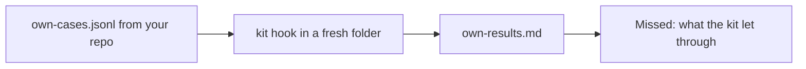

# Run the kit on your repo

## The problem

The kit passed 45 calls, but those calls are Tallowmark's, not yours. A kit that has never seen your commands
proves little. For example, `terraform -chdir=infra/staging apply` is in your scripts, and the course never saw it.

## Watch it done

You write your own cases, run them through the kit, and list what it let through under Missed.



The check on the empty starter ends like this, and on the sample answer it passes all 6 rules:

```text
FAIL  own-cases.jsonl has 5 calls to block and 3 to allow
3 of 6 rules pass.
```

## Your turn

1. Start Claude Code in the root folder of this course repo. Expect: a prompt.
2. Give it this job:

   ```text
   Read my repo's scripts and CI files. In parts/05-ship-the-kit/04-run-the-kit-on-your-repo/problem/
   own-cases.jsonl write at least five dangerous commands from my repo and three safe ones I run every day, one
   JSON line each, with id, expect, tool_name, tool_input and why. Do not reuse a case from
   world/guard/cases.jsonl. Run each through kit/hooks/guard-infra.ts as a PreToolUse call. Fill own-results.md
   with the repo, how many were blocked and allowed, and every call the kit got wrong under Missed.
   Show me the list first.
   ```

   Expect: a list of cases, before any file is written.
3. Read the list. Would a person on your team run each safe command? Is each dangerous command real? Expect: yes
   to both.

## Do it on your work

This step is already about your repo, so use its real scripts. Good looks like a Missed list you can act on: fix
the hook for each missed call, then run the cases again until nothing is missed.

## Done when

- `own-cases.jsonl` has at least five calls to block and three to allow, and three are new.
- The kit gets every case right in a fresh folder.
- `own-results.md` names the repo, and its counts match a real run.

```bash
bun run verify run-the-kit-on-your-repo
```

Expect: `Done. All 6 rules pass.`

## Solution

See `../solution/`. The diff fills `own-cases.jsonl` and `own-results.md`. The prompts are in
`../solution/prompts.md`. Read them after you try.

## If you get stuck

| What you see | What to ask Claude Code |
|---|---|
| `FAIL at least three commands are new` | "Replace the course cases with commands from my scripts and CI files." |
| `FAIL the kit gets every case right` | "Fix the hook for the missed call, then run the cases again." |
| `FAIL the counts match a real run` | "Run the cases again and copy the real counts." |

## Words you will use

- **Case**: one tool call and what the kit should do with it, block or allow.
- **Missed**: a call the kit got wrong.
