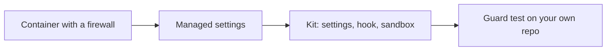

# Ship the kit

This part proves the **Goal**: the guardrail kit passes its test, and you ran it on your own repo.

## After this part you can

seal a container, ship one guardrail kit and prove it on your own repo.

## You leave with

a sealed devcontainer, a kit, a telemetry setting and your own kit results.

## The problem

A guard that lives on one laptop protects one laptop. The kit packs the settings, the hook and the sandbox so a team can copy them. The container and managed settings make them hard to switch off. For example, one copied folder gives a new teammate the same 30 blocked calls. Then you test the kit on your own repo, because a score on the course repo proves little.



## What you build

| Step | Minutes | What Claude Code makes for you | The check reads |
|---|---|---|---|
| `seal-the-devcontainer` | 25 | `.devcontainer/` with a firewall allow list and managed settings | The container config, the pinned version, the allow list and the managed settings keys |
| `ship-the-guardrail-kit` | 20 | `kit/` with settings, hook, sandbox block, guard test and a README for security | The guard suite run from the kit in a fresh copy of the world, and the README's sections |
| `export-the-telemetry` | 20 | `managed/managed-settings.json` that sends metrics and logs to the team collector | The env block: telemetry on, OTLP, an https collector, no prompts and no token |
| `run-the-kit-on-your-repo` | 25 | `own-cases.jsonl` and `own-results.md` from your own repo | The kit run on your cases in a fresh folder, and the counts in your results |

## Watch and read

| Kind | Title | Who made it | Why it is here | Link |
|---|---|---|---|---|
| video | Claude Code best practices for agentic coding | Anthropic, conference talk | The team that builds Claude Code shows the habits that keep agents safe and useful | https://www.youtube.com/watch?v=gv0WHhKelSE |
| video | Building effective agents | Anthropic, conference talk | Why a person stays in the loop, from the people who run agents in production | https://www.youtube.com/watch?v=D7_ipDqhtwk |
| read | Development containers | Anthropic, official docs | The sealed container pattern from the team that ships it | https://code.claude.com/docs/en/devcontainer |
| read | Monitoring usage | Anthropic, official docs | The telemetry settings this part exports | https://code.claude.com/docs/en/monitoring-usage |
| read | Server-managed settings | Anthropic, official docs | How one policy reaches every developer | https://code.claude.com/docs/en/server-managed-settings |
| read | Settings | Anthropic, official docs | Every key the shared kit sets | https://code.claude.com/docs/en/settings |

## Project

Run the kit on your own repo and read what it missed.

## Walkthrough

Check each step in order. Each prints PASS or FAIL lines, and a Try next line under every FAIL.

```bash
bun run verify seal-the-devcontainer
bun run verify ship-the-guardrail-kit
bun run verify export-the-telemetry
bun run verify run-the-kit-on-your-repo
```

Expect: `Done. All 9 rules pass.`, then 8, 6 and 6 rules, once each step is solved.

Check the whole part in one go:

```bash
bun run verify part ship-the-kit
```

Expect: `Part ship-the-kit is done: 4/4 steps pass.`
