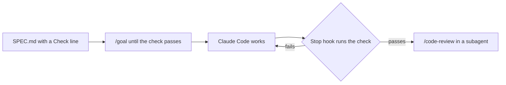

# Gate the goal with a Stop hook

## The problem

You say "fix the drift" and walk away. Claude Code says it is done, but it is not. A Stop hook is a script that
runs when Claude Code tries to stop. If a check fails, it sends the work back. For example, the plan still shows
drift, so the hook says no.

## Watch it done

A goal needs a stop condition a script can check, so "done" is a fact and not a mood.



The check on the empty starter ends like this, and on the sample answer it passes all 7 rules:

```text
FAIL  the Stop hook blocks when the check fails
0 of 7 rules pass.
```

## Your turn

1. Start Claude Code in the root folder of this course repo. Expect: a prompt.
2. Give it this job:

   ```text
   Interview me about putting prod's buyer records bucket back, one question at a time. Then in
   parts/06-work-in-parallel/01-gate-the-goal-with-a-stop-hook/problem/ write SPEC.md with Goal, Done when and
   Out of scope. Done when holds one line that starts Check: and is a read-only command. Write
   .claude/hooks/stop-gate.sh, a Stop hook that runs that line and exits 2 when it fails, and exits 0 when
   stop_hook_active is true. Wire it in .claude/settings.json. Write goal.txt with a /goal line that repeats the
   check, stops after a number of turns, and asks for /code-review in the code-reviewer subagent. Write
   .claude/agents/code-reviewer.md with tools that cannot Edit or Write. Show me your plan first.
   ```

   Expect: one question at a time, then a plan.
3. Read the plan. Could the Check line change prod? Could the hook trap the session in a loop? Expect: no to both.

## Do it on your work

Write a `SPEC.md` for one real job in your repo, with a read-only Check line that you trust. Good looks like a
Check that fails today and passes only when the job is truly done.

## Done when

- `SPEC.md` has Goal, Done when and Out of scope, and one read-only `Check:` line.
- The Stop hook blocks when the check fails, lets Claude Code stop when it passes, and lets a second stop through.
- `goal.txt` has a `/goal` line with the check, a turn limit and `/code-review`.
- The reviewer subagent cannot Edit or Write.

```bash
bun run verify gate-the-goal-with-a-stop-hook
```

Expect: `Done. All 7 rules pass.`

## Solution

See `../solution/`. The diff adds `SPEC.md` and `goal.txt`. The prompts are in `../solution/prompts.md`. Read
them after you try.

## If you get stuck

| What you see | What to ask Claude Code |
|---|---|
| `FAIL the hook blocks when the check fails` | "Exit 2 when the Check command fails, and print why on stderr." |
| `FAIL the hook lets a second stop through` | "Exit 0 when stop_hook_active is true." |
| `FAIL the reviewer subagent cannot Edit or Write` | "Set tools to Read, Grep, Glob and Bash." |

## Words you will use

- **Stop condition**: a check a script can run that says the goal is met.
- **Stop hook**: a script Claude Code runs when it tries to stop.
- **Subagent**: a helper with its own tools and its own context.
