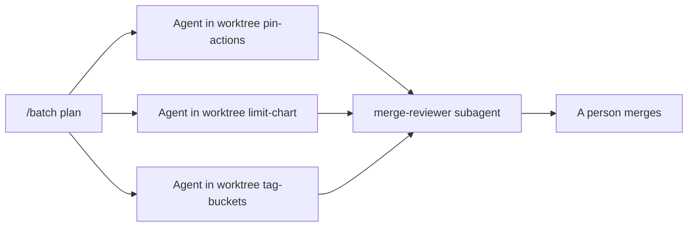

# Run agents apart

## The problem

Three jobs wait: pin the actions, add chart limits, tag the buckets. Three agents in one folder overwrite each
other. A worktree is a second copy of the repo on its own branch. For example, two agents both edit
`workflows/ci.yml`, and the second erases the first.

## Watch it done

Each agent gets its own worktree and its own files. A reviewer reads the results, and a person merges.



The check on the empty starter ends like this, and on the sample answer it passes all 6 rules:

```text
FAIL  no path belongs to two units
0 of 6 rules pass.
```

## Your turn

1. Start Claude Code in the root folder of this course repo. Expect: a prompt.
2. Give it this job:

   ```text
   In parts/06-work-in-parallel/02-run-agents-apart/problem/ split three jobs so no file belongs to two of them:
   pin the actions in workflows/ci.yml, add limits in charts/seat-api/values.yaml, tag the buckets in
   terraform/modules/scan-store. Write batch.md with a Command section holding one /batch line, and a Units table
   of each unit and the paths it may change. Write scripts/start-agents.sh that starts one claude -w per unit with
   a different name, in print mode, with a permission mode and a turn limit, then waits. Write
   .claude/agents/merge-reviewer.md with tools that cannot Edit or Write. Show me your plan first.
   ```

   Expect: a plan, before any file is written.
3. Read the plan. Does any path appear in two units? Does the reviewer merge anything? Expect: no to both.

## Do it on your work

Split three real jobs in your repo so that no file belongs to two of them. Good looks like a Units table a
teammate can read in one minute.

## Done when

- `batch.md` has a `/batch` line and at least three units with no shared path.
- The script starts at least three agents with `claude -w`, each with its own name, a permission mode and a turn
  limit.
- The reviewer subagent cannot Edit or Write.

```bash
bun run verify run-agents-apart
```

Expect: `Done. All 6 rules pass.`

## Solution

See `../solution/`. The diff adds `batch.md` and `scripts/start-agents.sh`. The prompts are in
`../solution/prompts.md`. Read them after you try.

## If you get stuck

| What you see | What to ask Claude Code |
|---|---|
| `FAIL no path belongs to two units` | "Give each unit its own file or folder, and list them in the table." |
| `FAIL every agent has its own worktree name` | "Give each claude -w a different name." |

## Words you will use

- **Worktree**: a second copy of the repo on its own branch, so two agents never share a file.
- **Batch**: one request that Claude Code splits into many units of work.
