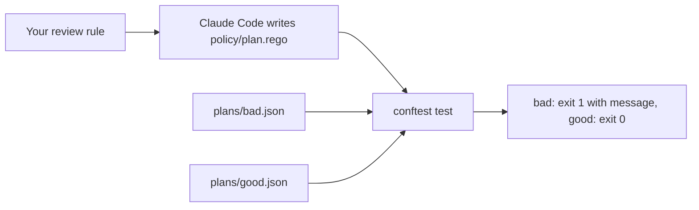

# Write the plan policy

## The problem

One review rule matters most: never delete or replace a resource that holds data. Today that rule lives only in a prompt. A policy file is a rule that any pipeline can run.

For example, the saved plan `plans/bad.json` deletes the orders database. The policy must fail it.

## Watch it done



The sample answer fails the bad plan with a message that names the resource, and passes the good plan, which only updates a queue:

```text
FAIL - plans/bad.json - main - aws_db_instance.orders holds data and this plan deletes or replaces it. Remove the delete from the plan, or set deletion_protection and plan again.
```

## Your turn

You write no code. Start Claude Code in this `problem/` folder.

1. Give it this job:

```text
Write one Rego rule in policy/plan.rego. It must deny any resource_changes entry whose type is
aws_db_instance or aws_s3_bucket and whose change.actions includes "delete". Make the message name the
resource and say what to fix. Run conftest test --policy policy on plans/bad.json and plans/good.json.
Then write three unit tests in policy/plan_test.rego (a delete, a replace and an update) and run
conftest verify --policy policy.
```

Expect: the bad plan fails with your message, the good plan passes, and `conftest verify` passes.

2. Put the prompts you used in `prompts.md`. Then check your work from the course root:

```bash
bun run verify write-the-plan-policy
```

Expect: `Done. All 3 rules pass.`

## Do it on your work

Save a plan from your own Terraform with `terraform show -json`. Pick one resource type that holds data in your project. Ask Claude Code for a deny rule on that type, plus a test for a delete and an update. Good looks like a message naming the resource, and a pipeline step that fails on it.

## Done when

- `conftest --version` reports the pinned version.
- The bad plan fails with your message and the good plan passes.
- `conftest verify --policy policy` passes with at least one test.

## Solution

The after state is in `../solution/`. It adds the rule in `policy/plan.rego` and its tests in `policy/plan_test.rego`. The prompts are in `../solution/prompts.md`.

## If you get stuck

- Read the `Try next` line under the failing rule.
- A Rego rule that never fires is the usual cause. Run `conftest test --policy policy plans/bad.json` and read what it prints.
- Ask Claude Code to explain each line of the rule before you accept it.

## Words you will use

- **Plan JSON:** what `terraform show -json` prints for a saved plan.
- **Rego:** the policy language of Open Policy Agent.
- **deny rule:** a rule that adds a message when a plan breaks it. Any message makes `conftest test` fail.
- **unit test:** a small Rego rule named `test_...` that `conftest verify` runs against sample input.
